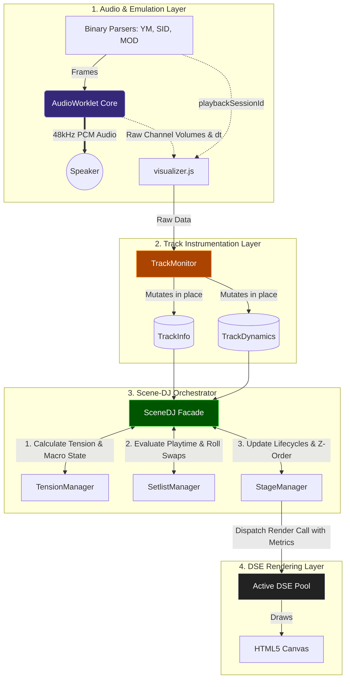

Here is the completely revised and expanded **Technical Specification** for `v1.2.0`. It now fully documents the ECS (Entity-Component-System) architecture, the zero-allocation data models, the separated DJ skills, and features the brand-new chapter detailing all DSEs and their precise reactions to macro/micro dynamics.

Save this document as `doc/Technical_spec.md`.

***

```markdown
# 💾 TECHNICAL SPECIFICATION: AUDIO-VISUAL PIPELINE & SCENE-DJ ARCHITECTURE
**Version:** 1.2.0 (Modular ECS-Pattern Revision)

This document outlines the architectural blueprint of the Chiptunes Fantasy real-time audio-visual pipeline. To maintain strict separation of concerns and guarantee 60FPS performance on low-end devices, the system decouples audio emulation, DSP analysis, scene orchestration, and rendering into distinct, zero-allocation modules.

---

## 1. The Audio-Visual Pipeline

The core rendering loop utilizes a **Unidirectional Data Flow**. State changes propagate strictly from the application layer down to the visual layer. The `SceneDJ` acts as a facade, coordinating data between specialized sub-modules ("Skills") without executing rendering code itself.



---

## 2. Track Instrumentation (`TrackMonitor`)

The `TrackMonitor` serves as the bridge between the raw audio output and the visual orchestrator. Its sole responsibility is to translate raw `channelVolumes` and app state into two highly structured, **zero-allocation data classes**.

### 2.1. `TrackInfo` (Static Context)
Contains metadata about the currently playing song. 
*   `system` (String): The active hardware tab (`'c64'`, `'amiga'`, `'atari'`).
*   `sessionId` (Number): A monotonically increasing ID. When this changes, the DJ executes a hard reset on tension accumulators (Unidirectional State Syncing).
*   `isPlaying` (Boolean): Global playback state driving the "Instant Wake-Up" or "Soft Sleep" transitions.

### 2.2. `TrackDynamics` (Real-Time Metrics)
Updated every frame (60Hz). Contains the heavily filtered DSP metrics utilized by the DSEs.
*   `masterEnergy` (Float): The RMS moving average of all active channels.
*   `transientPulse` (Float): True rising-edge delta measuring instantaneous drum hits (`max(0, raw - smooth)`).
*   `beatEnvelope` (Float): An exponential decay curve (`0.0 -> 1.0`). It starts at full amplitude for every accepted beat and retains the existing binary timing semantics.
*   `beatStrength` (Float): Continuous strength (`0.0 -> 1.0`) of the last accepted beat. Hardware and analog candidates are combined by maximum rather than summed.
*   `beatLevel` (Integer): Shared classification of that strength: `0` = none, `1` = soft, `2` = medium, `3` = hard.
*   `beatImpulse` (Float): Strength-weighted microdynamic response, calculated as `beatEnvelope[0] × beatStrength` and decaying without changing the retained strength or level.
*   `beatStarted` / `beatCount`: Exact one-frame beat event and monotonic beat number for discrete pattern, palette, formation, direction, or layout changes.
*   `rawEnergyState` (String): The instantaneous, debounced threshold evaluation (`'playing'`, `'buildup'`, `'climax'`).

---

## 3. The Scene-DJ (Coordinator & Skills)

The `SceneDJ` delegates all logic to specialized "Skills" (Sub-Modules).

### Skill 1: `TensionManager` (Macro-Dynamics)
Reads the crowd and builds suspense using a mathematical accumulator (`tension`).
*   **Logic:** Integrates `masterEnergy` and `transientPulse` over time. If the track hits an overdrive threshold, accumulation is multiplied by `4x` or `6x`. 
*   **The Climax Lock:** Once `tension >= 20.0`, the state locks into `climax`. The hold timer only drains when the track's real-time energy falls below overdrive thresholds, ensuring visually rewarding drops.
*   **Debouncing:** Implements a `0.5s` `MIN_BUILDUP_TIME` to prevent chaotic visual flickering between `playing` and `buildup` states.

### Skill 2: `SetlistManager` (Crate Digger / Swapping)
Responsible for variety and aesthetic coherence.
*   **Weighted Roulette Selection:** Uses `metadata.weight` to randomly select elements for a specific layer.
*   **Dynamic Weight Penalties:** If the roulette re-selects the currently active DSE, its `weight` is halved and its `stateTime` is reduced by 5s to force faster re-rolls, preventing visual stagnation.
*   **Black-Screen Protection:** Evaluates the active pool. If all non-overlay layers resolve to `isVoid === true`, it forces a re-roll of one layer to a physical GFX element to ensure the canvas is never completely empty.

### Skill 3: `StageManager` (Lifecycle & Crossfades)
The stage technician managing the active visual pool.
*   **State Machine:** Routes DSEs smoothly through `idle` $\to$ `starting` (1.5s) $\to$ `[macroState]` $\to$ `stopping` (1.5s) $\to$ `idle`.
*   **Instant Wake-Up:** Bypasses debouncing when transitioning from a stopped (`idle`) state to playback, triggering an immediate visual fade-in and a fresh DSE roulette roll.
*   **Z-Order Sorting:** Enforces strict rendering order (`background` $\to$ `floor` $\to$ `foreground` $\to$ `overlay`).
*   **Graded Metrics Routing:** Clamps `beatStrength`, maps `beatLevel` through the shared `getBeatLevel(...)` thresholds, and forwards `beatImpulse` to the persistent DSE metrics wrapper.
*   **Legacy Compatibility:** Metrics without graded fields retain full-strength beat behavior. A reusable one-element buffer supplies the impulse fallback without allocating new metric arrays in the render loop.

---

## 4. DSE Metadata Contract

Visual effects are decoupled classes registered inside `dse/registry.js`. The `defineDSE` wrapper validates the schema at compile time.

| Property | Type | Description |
| :--- | :--- | :--- |
| `name` | `String` | Human-readable class identifier. |
| `computerType` | `Array` | Hardware compatibility (`['c64']`, `['amiga']`, `['atari']`, `['all']`). |
| `placementType` | `String` | Z-Order assignment (`background`, `floor`, `foreground`, `overlay`). |
| `weight` | `Number` | Relative probability weight for the Roulette-Wheel selection. |
| `minPlayTime` | `Number` | Minimum seconds the DSE must run before it can be swapped. `Infinity` creates a permanent lock (used for the LimitBar). |
| `climaxHoldTime`| `Number` | The duration (in seconds) the DSE requests to stay in climax after track energy drops. The DJ uses `Math.max()` of all active DSEs. |
| `isVoid` | `Boolean` | Flags a zero-CPU transparent placeholder used for screen clearing. |

---

## 5. DSE Arsenal & Reactivity Mapping

Demo-Scene-Elements are designed to react to **Macro-Dynamics** (the overall `state` string managing base speed and pattern complexity) and **Micro-Dynamics**. Continuous reactions use `metrics.beatImpulse[0]`, while discrete changes require the exact `beatStarted`/`beatCount` event. A retained beat level during envelope decay is not a new event. All spatial modifiers are wrapped in "Continuous Math" low-pass interpolators to prevent visual teleportation during state transitions.

### 5.1. `LimitBar` (Overlay, currently disabled)
*   **Function:** Borderless tension accumulation meter, retained for isolated diagnostics but excluded from the active setlist through `.disabled()`.
*   **Macro-Reaction:** Bar width is mapped precisely to `tensionPct`. Color milestones change based on segment position (50% warning, 100% climax).
*   **Micro-Reaction:** `beatImpulse[0]` grades C64 raster borders, the Amiga sweep, and Atari spark count/length. The climax strobe also follows the weighted impulse.
*   **System Styling:** C64 chunky blocks & rasterbars; Amiga copper-sweeps; Atari ST quantized neon segments & aliased vector sparks. Entry and exit use a structural vertical slide without alpha blending.

### 5.2. `RetroSunset` (Background)
*   **Function:** IK+ inspired landscape.
*   **Macro-Reaction (`state`):** Controls the base target speed of the scrolling water waves and base distortion amplitude.
*   **Micro-Reaction (`beat`):** In `buildup`/`climax` states, the size of the Sun and the X-axis distortion of the water lines expand instantaneously with the beat envelope.
*   **System Styling:** C64 chunky pixel blocks; Amiga copper sky gradients and sub-pixel sine-waves; Atari ST strict 16-color raster bands and horizontal sine displacement.

### 5.3. `Starfield` (Background)
*   **Function:** Universal 3D warp starfield.
*   **Macro-Reaction (`state`):** Adjusts the base Z-axis warp velocity (`smoothedWarp`).
*   **Micro-Reaction (`beatImpulse`):** Grades instantaneous warp travel and system accents: C64 raster wobble, Amiga nebula/climax brightness, and an integer Atari star-size kick.
*   **Discrete Events:** Pattern and palette changes still require exact `beatStarted`/`beatCount` events; envelope decay cannot retrigger them.
*   **System Styling:** Deterministic recycling, integer rasterization, system-correct palettes, and bounded star pools on every system.

### 5.4. `Copperbars` (Floor)
*   **Function:** 3D Helix rasterbars.
*   **Macro-Reaction (`state`):** Scales the orbital `targetAmplitude` and rotation `targetSpeed`. Transitions unlock new behavioral patterns.
*   **Micro-Reaction (`beatImpulse`):** Grades the vertical nudge, climax interference, and core `punch` thickness. Formation and Copperlist changes remain restricted to exact fourth-beat events.

### 5.5. `TrackPresenter` (One-Shot Overlay)
*   **Function:** Three-second track-information overlay rendered entirely with deterministic bitmap typography.
*   **Micro-Reaction (`beatImpulse`):** Grades system-specific panel movement in `playing`, `buildup`, and `climax`; the climax also adds a horizontal title nudge.
*   **Discrete Events:** Layout changes remain restricted to exact fourth-beat events. Afterglow adds no panel kick, and the one-shot lifecycle is unchanged.

### 5.6. `AmigaCube` / `AtariBobs` (Foreground)
*   **Function:** Central 3D focal points (Glenz Vector Cube / Pre-rendered Lissajous Sprites).
*   **Macro-Reaction (`state`):** Increases target orbital or rotational speeds.
*   **Micro-Reaction (`beat`):** Modulates the `scaleMultiplier` causing the 3D objects to physically inflate and bounce to the kick drum.
*   **Special:** `AtariBobs` features strict aspect-ratio preservation, mapping its X/Y radii to `Math.min(width, height)` to prevent squishing on mobile screens.

### 5.7. `VoidElement` (Floor / Background / Foreground)
*   **Function:** A structural placeholder returning empty render passes. It intentionally has no beat response, reads no visual metrics, and issues no drawing operations.
*   **Usage:** Allows the DJ's Roulette-Wheel to periodically clear specific Z-layers (e.g., hiding the Copperbars) to let the background elements breathe. Secured by the DJ's Black-Screen Protection to ensure the screen never goes completely blank.
```

***

